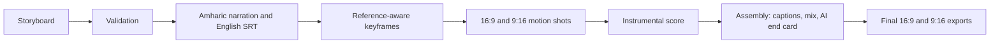
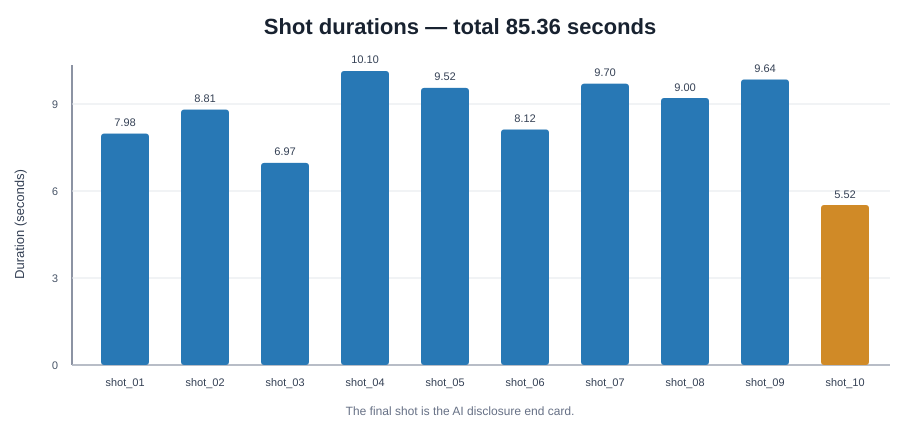
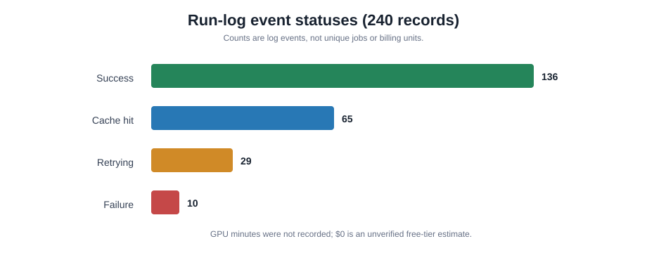

# Ato Girma's Promise: Production and Audience-Test Report

**Assignment:** AI Content Generation
**Project:** *Ato Girma's Promise* (የአያቴ ግርማ ቃል ኪዳን)
**Report date:** November 26, 2026

## Executive summary

This project developed a 10-shot Amharic heritage short with English
subtitles, an instrumental underscore, and a visible AI disclosure end card.
The storyboard and current exports run **85.36 seconds**, inside the
assignment's 60–90-second window. There are landscape 16:9 and portrait 9:16
versions. The pipeline validates the storyboard, creates or reuses narration,
reference-aware keyframes, motion shots, and music, then assembles the final
cuts with ducked music, loudness normalization, burned-in English captions,
and a selectable subtitle stream.

The project files and final media are present locally. The repository has not
been pushed, and no public video or walkthrough links are recorded here. Most
importantly, the source, license, and likeness/consent status of all four
reference images remain **unverified**. The GitHub repository must remain
Private until those rights are verified or the affected images are replaced.

## 1. Audience and story intent

The intended audience is young adults, families, viewers interested in
Ethiopian heritage stories, and diaspora viewers negotiating personal
ambitions and family ties. The story follows Eden as she weighs leaving to
pursue an opportunity. Her grandfather, Ato Girma, shares regret about a
promise to give his loved ones time. He does not ask Eden to abandon her
future.

The emotional intention is to hold ambition and family care together rather
than frame Eden's plans as disloyalty. The story asks viewers to consider
which relationships and promises deserve their time now, and which
conversations should not be postponed.

The film is narrated in Amharic and subtitled in English. Its title is *Ato
Girma's Promise* (የአያቴ ግርማ ቃል ኪዳን).

## 2. Production approach and deliverables

The storyboard is the source contract for 10 sequential shots. It contains
visual, keyframe, motion, music, narration, subtitle, seed, and duration
fields. Its ten shot durations sum to 85.36 seconds and align with the saved
per-shot narration WAVs.

The production stages are:

1. Validate storyboard structure, references, shot order, and duration.
2. Generate or reuse Amharic narration and produce an English SRT.
3. Generate/reuse reference-aware keyframes and render subtle motion clips
   for both aspect ratios.
4. Create an instrumental score and assemble the final exports.

The pipeline uses content-addressed SHA-256 caching, retry/backoff for
transient errors, and append-only JSONL logging. The default visual generator
is Cloudflare Workers AI Flux Schnell. Since this endpoint is text-to-image,
the listed reference images are described using the configured reference
captioning model and filename-specific visual anchors are added to the
prompt. Keyframe checks reject corrupted or near-blank images. Motion renders
preserve the full keyframe over a blurred background instead of aggressively
cropping people for portrait output.

The two final exports are `outputs/final_16x9.mp4` and
`outputs/final_9x16.mp4`; `outputs/subtitles.srt` is retained separately.
Subtitles are burned into both cuts and also included as a selectable
subtitle stream. The instrumental score is mixed under narration with
sidechain ducking and loudness normalization. The final shot is a programmatic
end card that states **“AI-assisted film”** and **“Created with the assistance
of artificial intelligence.”**

### Duration by shot

The longest storyboard slot is 10.10 seconds and the end-card slot is 5.52
seconds. All ten slots together meet the required runtime range.

## 3. Audience tests and changes

Project documentation records **three audience members in each test**, using
audience-role labels rather than names. Session dates and participant names
are not present in the project notes. The Test 1 feedback below is summarized
from those notes rather than presented as verbatim quotes. Test 2 comments
below reproduce the comments recorded in the project notes; they should be
checked against original notes or recordings before submission if exact
quotation is required.

### User Test 1 — Radio Cut

The radio cut was approximately 84 seconds. The three roles and recorded
feedback were:

- **Young Adult / Diaspora viewer:** Eden's pushback felt relatable; speaker
  attribution needed to be clear when multiple lines occur in one shot.
- **Elder / Heritage Drama viewer:** The grounded tone worked; back-to-back
  dialogue needed more breathing room.
- **Short-Form / Creator viewer:** The pacing felt appropriate at about 84
  seconds; framing in shots 8–9 needed review for short-form presentation.

The project notes record three resulting changes: Amharic spelling/phrasing
and corresponding English subtitles were tightened; dialogue speaker labels
were retained; and shot durations were aligned to the narration audio. The
storyboard total at that review is recorded as 84.43 seconds. The current
storyboard and saved narration WAVs total 85.36 seconds. Shots 8–9 also
received visual-framing and character/location-anchor revisions.

### User Test 2 — Near-Final Cut

The near-final 16:9 and 9:16 cuts were reviewed at approximately 85.36
seconds. The comments recorded in the project notes are:

**Viewer 1 — Young Adult / Diaspora Viewer (story and emotional arc):**

> “The emotional arc lands much better now—seeing Eden in the blue dress and Ato Girma in his white shawl and patterned trim stay consistent through the conversation, especially when they sit together and talk about not putting off loved ones until tomorrow. Burning in the English subtitles makes it easy to follow every line right away.”

**Viewer 2 — Elder / Heritage Drama Viewer (tone, pacing, and clarity):**

> “The Amharic narration is calm, clear, and respectful, and the closing AI disclosure card is very easy to read. One small polish detail: in the second shot's English subtitle, Eden:"Grandfather... is missing a space after the colon, and when one shot has two speakers back-to-back, a brief pause makes the turn feel slightly more natural.”

**Viewer 3 — Short-Form / Content Creator Viewer (vertical and horizontal presentation):**

> “Both the 16:9 cut and the 9:16 cut keep the characters' faces and expressions clearly framed without cutting off heads. On the vertical 9:16 cut, the blurred side bars work cleanly, though a slightly cleaner, more compact subtitle placement in the bottom safe zone will keep the center of the scene even less covered during longer lines.”

The production changes recorded after this test were:

1. Corrected the shot 2 subtitle spacing to `Eden: “Grandfather...` and
   separated the two speakers onto different lines.
2. Reduced subtitle size and adjusted bottom-safe margins for both aspect
   ratios.
3. Regenerated the SRT and both final exports so they used the same updated
   subtitle styling and 85.36-second timing.
4. Preserved the request for a brief audible pause between speakers as a
   follow-up. The subtitle-only polish did not change the aligned narration
   WAVs.

## 4. Hardest problem and what was learned

The most substantial technical challenge was maintaining readable character
faces and visual continuity while adapting the same scenes to both wide and
portrait frames. Earlier visual review identified clipped heads, unclear
faces, inconsistent character appearance, and occasional unwanted props.
Prompt guardrails now ask for complete visible heads and faces, natural
headroom, complete anatomy, and no unrequested objects. Each shot uses only
its listed reference assets. Basic image integrity checks reject blank or
corrupt keyframes, and the motion renderer contains the entire keyframe rather
than center-cropping it for 9:16. User Test 2 notes reported that faces stayed
in frame in both exports.

A separate model-integration issue reinforced the importance of checking API
capabilities rather than assuming a model accepts standard parameters.
Cloudflare Flux Schnell rejected a request containing `seed`. The pipeline
stopped sending that unsupported field and instead places the shot seed in
the prompt, SHA-256 cache identity, and run log. This preserves a traceable
setting, but is not a guarantee that a hosted generation will be identical
across calls.

The early captioning model also returned an HTTP 410 after deprecation; the
reference-description stage was moved to the configured Cloudflare reference
model. These are documented in the project failure record.

## 5. Practices that helped and did not help

**Helpful practice — use explicit, shot-specific visual anchors and framing
guards.** Linking prompts to only the approved character/location references,
describing recognizable appearance details, and specifying headroom made
visual expectations clearer. Image-quality checks and safe-frame rendering
provided additional defenses against blank frames and aggressive crops.
Audience feedback on the near-final cuts supported keeping the approach.

**Unhelpful practice — sending a `seed` field to the default Flux endpoint.**
The endpoint rejected it with HTTP 400. The request failed rather than
providing deterministic output. Recording the seed in prompt/cache/log inputs
was the compatible alternative; the model call still cannot promise
bit-for-bit repeatability.

## 6. Production ceiling, costs, and limitations

The production achieved two 85.36-second aspect-ratio exports with narration,
English subtitles, instrumental underscore, and an AI disclosure end card.
It also established selective shot regeneration, retries, caching, and
run-summary reporting. The shot durations were measured against the narration
WAVs, not estimated from subtitle length.

The latest run summary reports **240 log records**: **136 successes**, **65
cache hits**, **29 retry events**, and **10 historical failures**. Those
failures include eight TTS failures associated with rate/quota limits and two
historical keyframe/reference-stage failures. The project records that the
affected narration was later regenerated and that the Flux seed handling was
changed.

The run log has no GPU-minute estimates or provider billing fields. The
reported **$0** cost is a free-tier estimate, not verified account billing.
Free-tier TTS limits caused HTTP 429 responses and constrained when additional
narration could be generated. Visual generation also required prompt
iteration and manual review; the automated image checks do not prove semantic
likeness or artistic quality.

## 7. Ethics, rights, and disclosure

The four image references are `eden.jpeg`, `girma.png`, `living_room.jpg`,
and `story_telling_area.jpg`. Their origins, licenses, and likeness/consent
status are **not verified in the project records**. This report does not
assert that they are AI-generated, self-created, stock, licensed, or used with
consent. The repository must stay Private until every asset's rights and
consent are verified or that asset is replaced. Do not publicly distribute
recognizable likenesses without permission.

The completed end card provides an in-film disclosure. If the film is
uploaded to YouTube, the uploader must also apply the platform's AI/altered
content disclosure when required; one disclosure does not replace the other.
The upload should retain accessible English subtitles.

## 8. Next steps

1. Verify and record the origin, terms, attribution, and any likeness consent
   for all four references, or replace unverified images and regenerate
   affected shots. Keep GitHub Private until complete.
2. Compare the quoted Test 2 comments with original notes/recordings, verify
   participant counts and session details, and retain consent/evidence without
   exposing participant identities unnecessarily.
3. Decide whether to add the suggested speaker-turn pause. If narration
   changes, regenerate affected audio, recheck shot timing and total runtime,
   and reassemble both aspect ratios.
4. Rewatch both final exports after publishing, confirm captions and the end
   card, and apply YouTube's current AI/altered-content setting.
5. Record the required walkthrough (no more than five minutes), publish the
   required post, and add accessible links for both cuts, walkthrough, and
   repository to the assignment submission.

The assignment submission links and public-post screenshot are not included
in this report because those external publishing steps have not been
documented as complete.

## Evidence figures

The charts are derived from the validated storyboard and the local run-log
summary; they do not contain reference photos or generated character images.
Final video files are in the Git-ignored `outputs/` directory and need to be
uploaded separately for assessors to access.

- [Shot-duration chart](report_shot_durations.svg)
- [Run-log status chart](report_run_summary.svg)
